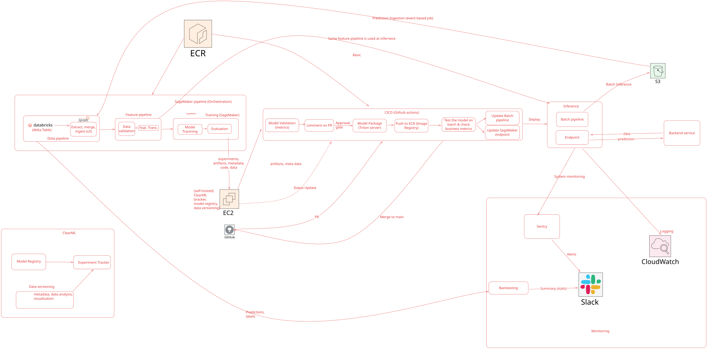

# ML Platform: AWS → GCP

How I would take the ML platform I built on AWS at Revic to Google Cloud, in two steps:

1. **Like-for-like migration:** every component of the Revic platform mapped to its closest GCP service, with what overlaps and what doesn't.
2. **GCP-native platform:** the same capabilities rebuilt GCP-native and demonstrated on one workload: classifying web pages by topic (web page → IAB topic → Bigtable lookup). The model is deliberately simple so the design focuses on MLOps.

Every GCP capability claim was checked against the official documentation on 2026-11-08.

## Read in this order

| # | Document | What it answers | Time |
|---|---|---|---|
| 1 | [BRIEF-aws-to-gcp.md](BRIEF-aws-to-gcp.md) | **Start here.** AWS → GCP grouped by capability: pipelines, experimentation, rollout, monitoring, infrastructure. What carries over and where the gaps are | 5 min |
| 2 | [AWS-to-GCP-service-map.md](AWS-to-GCP-service-map.md) | Component-by-component detail behind the brief, with doc links for every claim | 15 min |
| 3 | [CAPABILITY-MAP.md](CAPABILITY-MAP.md) | The GCP-native platform on a page-topic workload: model assumptions, decision log, data contracts, rollout, monitoring, compliance and roadmap | 20 min |

The diagram above is the original Revic AWS architecture ([ml-platform-graph.svg](ml-platform-graph.svg)).

## Key points

- **Half the stack moves unchanged:** Databricks (Delta tables), ClearML, GitHub Actions, Triton, Sentry and Slack. The real migration is SageMaker, S3, ECR, CloudWatch and IAM.
- **The gaps are in model rollout and serving.** SageMaker's deployment guardrails and shadow tests have no managed equivalent on Agent Platform (formerly Vertex AI), and GPU multi-model Triton hosting doesn't carry over.
- **The GCP-native design turns those gaps into platform features:** precomputed Bigtable lookups instead of per-request inference, shadow → canary → pointer-flip rollouts with automatic rollback, traceable training, and label-driven retraining. It runs EU-only and is designed for SOC 2.
- **Simplified on purpose:** v1 is one task (tier-1 topic) read from BigQuery, so the effort goes into training traceability, rollout and monitoring rather than modelling.

## License

The documents and diagram are licensed under [CC BY 4.0](LICENSE).
